<!--
  Profile README — ambient purple edition
  Animated SVG is self-contained; if GitHub disables SVG animation,
  the artwork still has a static constellation fallback.
-->

  

  
  
  

## > whoami

I'm **Yash**, a backend-focused engineer who enjoys the overlap between **security, automation, and product engineering**. I like turning messy problems into useful, dependable tools — and adding a little creativity along the way.

- 🧩 **Backend:** Laravel, PHP, APIs, database design
- 🔐 **Security:** secure coding, web/API testing, practical application security
- ⚙️ **Automation:** CI/CD, n8n workflows, integrations, developer tooling
- 🧪 **Exploring:** AI-powered products, open-source tools, and smarter developer workflows

## > currently_building

| Signal | What I'm interested in |
| --- | --- |
| **Secure by design** | Better defaults, safer request flows, resilient applications |
| **Automation-first** | Removing repetitive work with workflows and integrations |
| **Product mindset** | Small, useful tools that solve real problems |
| **Continuous learning** | AI engineering, application security, and system design |

## > toolkit

  
  
  
  
  
  
  

## > selected_work

- **[LarAgent](https://github.com/yash22nayak/LarAgent)** — a public project in the Laravel ecosystem.
- **[catch-domain](https://github.com/yash22nayak/catch-domain)** — a public domain-related project.
- **[GitHub repositories →](https://github.com/yash22nayak?tab=repositories)** — explore more of my work.

## > connect

I'm interested in thoughtful engineering, open-source collaboration, security-minded development, and ideas that can become useful products.

  <a href="https://github.com/yash22nayak">GitHub</a>
  &nbsp;·&nbsp;
  <a href="https://github.com/yash22nayak?tab=repositories">Projects</a>

---

Designed with a little purple, a constellation of dots, and a lot of curiosity.

